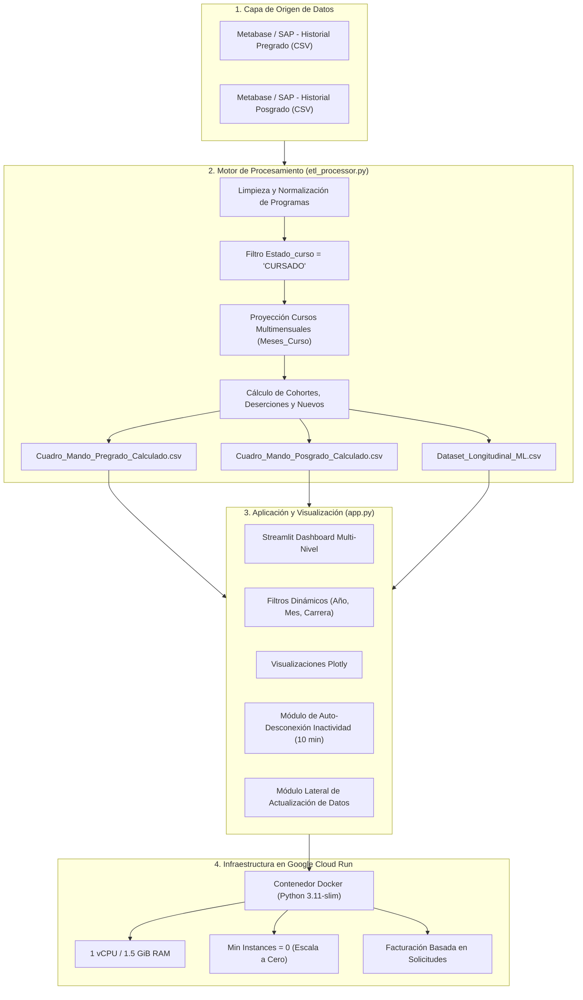

# 📘 Documentación Técnica y Manual de Operaciones
## Sistema de Análisis Estratégico, Crecimiento y Deserción — USMP Virtual
**Versión de Producción:** Noviembre 2026  
**URL Oficial en la Nube:** [https://sistema-analisis-estrategico-desercion-usmp-960324457000.europe-west1.run.app](https://sistema-analisis-estrategico-desercion-usmp-960324457000.europe-west1.run.app)  
**Repositorio GitHub:** `https://github.com/ibertolottic-creator/an-lisis-de-crecimiento-desde-metabase`

---

## 📑 Tabla de Contenidos
1. [Resumen Ejecutivo y Propósito](#1-resumen-ejecutivo-y-propósito)
2. [Arquitectura del Sistema y Flujo de Datos](#2-arquitectura-del-sistema-y-flujo-de-datos)
3. [Estrategia de Blindaje y Reducción de Costos ($0 en Reposo)](#3-estrategia-de-blindaje-y-reducción-de-costos-0-en-reposo)
4. [Manual de Operaciones: Proceso de Actualización Mensual](#4-manual-de-operaciones-proceso-de-actualización-mensual)
5. [Reglas de Negocio y Diccionario de Métricas](#5-reglas-de-negocio-y-diccionario-de-métricas)
6. [Estructura del Proyecto y Archivos](#6-estructura-del-proyecto-y-archivos)

---

## 1. Resumen Ejecutivo y Propósito

El **Sistema de Análisis Estratégico y Deserción - USMP** es una solución analítica de alto rendimiento diseñada para monitorear, auditar y proyectar la dinámica estudiantil de las carreras de **Pregrado** y maestrías/doctorados de **Posgrado** de la USMP Virtual desde el año 2014 hasta la actualidad.

### Objetivos Clave:
* **Eliminar falsas deserciones:** Reconoce y proyecta automáticamente cursos que duran más de un mes (`Meses_Curso` de 2 a 6 meses), protegiendo la condición activa del estudiante.
* **Trazabilidad longitudinal:** Modela la trayectoria individual de cada alumno mes a mes para alimentar modelos de Machine Learning (detección temprana de riesgo de abandono).
* **Consumo ultra-económico en la nube:** Diseñado para operar a costo prácticamente nulo (\$0.00 en reposo) mediante apagado automático tras 10 minutos de inactividad.

---

## 2. Arquitectura del Sistema y Flujo de Datos

El sistema sigue una arquitectura moderna desacoplada en 4 capas:



---

## 3. Estrategia de Blindaje y Reducción de Costos ($0 en Reposo)

Para evitar consumos accidentales de nube (como facturaciones cuando un directivo o analista deja abierta la pestaña del navegador), el sistema cuenta con **protección activa en 2 niveles**:

### Nivel 1: Frontend (Script de Auto-Desconexión por Inactividad)
* **Detección continua:** Escucha eventos de usuario en la ventana principal (`mousemove`, `mousedown`, `keydown`, `scroll`, `touchstart`).
* **Temporizador de 10 minutos:** Si transcurren 10 minutos sin actividad:
  1. Cierra forzosamente todas las conexiones WebSocket activas con el servidor.
  2. Sustituye la clase `WebSocket` por un objeto inerte (*dummy*) para evitar que Streamlit intente reconectarse en segundo plano.
  3. Muestra una pantalla superpuesta (*modal overlay*) en diseño oscuro con desenfoque de fondo:
     > **⏸️ Sesión Pausada por Inactividad**  
     > *Para proteger los recursos de la universidad y evitar costos innecesarios en Google Cloud, la conexión del servidor se apagó automáticamente tras 10 minutos sin actividad.*  
     > `[ 🔄 Reanudar Dashboard ]`
* **Apagado en la Nube:** Al no haber solicitudes ni conexiones abiertas, Google Cloud Run detecta **0 usuarios activos y apaga el contenedor**. El consumo baja instantáneamente a **\$0.00**.

### Nivel 2: Infraestructura en Google Cloud Run
* **CPU:** 1 vCPU (50% de ahorro frente a configuraciones estándar).
* **RAM:** 1.5 GiB optimizados.
* **Instancias Mínimas:** `min-instances = 0` (el servidor no existe físicamente si nadie está dentro).
* **Instancias Máximas:** `max-instances = 2` (impide saturación o ataques de bots).
* **CPU Throttling:** Activado (`--cpu-throttling`), congelando el cómputo entre peticiones.
* **Request Timeout:** 600 segundos (10 minutos límite estricto).

---

## 4. Manual de Operaciones: Proceso de Actualización Mensual

El usuario tiene **dos formas sumamente fáciles** de actualizar la información cada mes:

### Método A: Desde la Web (En el Dashboard)
*Ideal para cuando estás fuera de la oficina o en otra computadora:*

1. Abre el dashboard en el navegador: [https://sistema-analisis-estrategico-desercion-usmp-960324457000.europe-west1.run.app](https://sistema-analisis-estrategico-desercion-usmp-960324457000.europe-west1.run.app).
2. En la barra lateral izquierda, despliega la pestaña **`🔄 Actualización Mensual de Datos`**.
3. Arrastra los 2 archivos CSV descargados de Metabase:
   - Archivo de **Pregrado**.
   - Archivo de **Posgrado**.
4. Haz clic en el botón azul **`🚀 Procesar`**.
5. Espera ~25 segundos. El sistema calculará las métricas, invalidará la caché anterior y recargará los gráficos con los nuevos meses.
6. *(Opcional)*: Puedes descargar los cuadros calculados resultantes con los botones `📥 Descargar Pregrado (.csv)` y `📥 Descargar Posgrado (.csv)`.

---

### Método B: Con 1 Doble Clic desde tu PC (Recomendado)
*Ideal porque no requiere subir archivos pesados por la web y corre a la máxima velocidad:*

1. Descarga las bases del nuevo mes desde Metabase.
2. Cópialas en la carpeta `data/Bases de datos [mes año]/` de tu proyecto.
3. Haz doble clic en el archivo:
   ```cmd
   actualizar_y_publicar.bat
   ```
4. El script ejecutará automáticamente:
   - Activación de Python.
   - Ejecución del ETL en tu PC (15 segundos).
   - Generación de los archivos calculados.
   - Despliegue de la nueva versión hacia Google Cloud Run.
5. Al terminar, la versión en la nube quedará actualizada automáticamente.

---

## 5. Reglas de Negocio y Diccionario de Métricas

### 5.1. Reglas de Inclusión y Filtrado
1. **Matrícula Activa:** Solo se consideran registros donde `Estado_curso == 'CURSADO'`.
2. **Cursos Multimensuales (`Meses_Curso`):**
   Si una asignatura dura $N$ meses ($N \ge 2$), el estudiante se proyecta como activo durante los $N-1$ meses posteriores. Esto evita falsas alertas de abandono en programas modulados o bimestrales.
3. **Admitido Matriculado:** Estudiante cuyo DNI registra su primera matrícula activa en toda la historia de ese programa académico.
4. **Concluyeron el Plan:** Estudiantes que alcanzaron el último ciclo o estado de egreso registrado.
5. **Recuperados:** Alumnos que no estuvieron matriculados en el mes anterior pero volvieron a matricularse en el mes actual.

### 5.2. Fórmulas de Deserción y Crecimiento

| Métrica | Definición y Fórmula |
| :--- | :--- |
| **Deserción Temprana (3-6m)** | Estudiantes inactivos entre 3 y 6 meses consecutivos. |
| **Deserción Tardía (7-12m)** | Estudiantes inactivos entre 7 y 12 meses consecutivos. |
| **Deserción Muy Tardía (>12m)** | Estudiantes sin matrícula por más de 12 meses continuos. |
| **Riesgo Deserción (1m y 2m)** | Alumnos sin matrícula en el mes inmediato anterior o hace 2 meses (ventana de alerta preventiva). |
| **Crecimiento Neto** | $(\text{Matrícula Mes Actual} - \text{Matrícula Mes Anterior})$. |
| **Tasa de Retención Genuina** | $\frac{\text{Alumnos Retenidos Activos}}{\text{Matrícula Mes Anterior}} \times 100\%$. |

---

## 6. Estructura del Proyecto y Archivos

```text
├── app.py                             # Aplicación interactiva Streamlit (Dashboard + UI + Auto-sleep)
├── etl_processor.py                   # Motor analítico y transformador de cohortes y deserciones
├── actualizar_y_publicar.bat          # Script de 1 clic para recalcular y publicar a Cloud Run
├── Dockerfile                         # Especificación del contenedor de producción
├── .dockerignore / .gcloudignore      # Filtros para excluir bases crudas pesadas (>400MB) del despliegue
├── requirements.txt                   # Dependencias de Python (Streamlit, Plotly, Pandas, Scikit-Learn)
├── DOCUMENTACION.md                   # Esta documentación técnica integral
├── Cuadro_Mando_Pregrado_Calculado.csv # Métricas precalculadas históricas de Pregrado
├── Cuadro_Mando_Posgrado_Calculado.csv # Métricas precalculadas históricas de Posgrado
├── Dataset_Longitudinal_ML.csv        # Dataset enriquecido de trayectorias para Machine Learning
└── data/                              # Repositorio de bases de datos crudas exportadas de Metabase
```

---
*Documento actualizado y verificado: Noviembre 2026 — USMP Virtual.*
